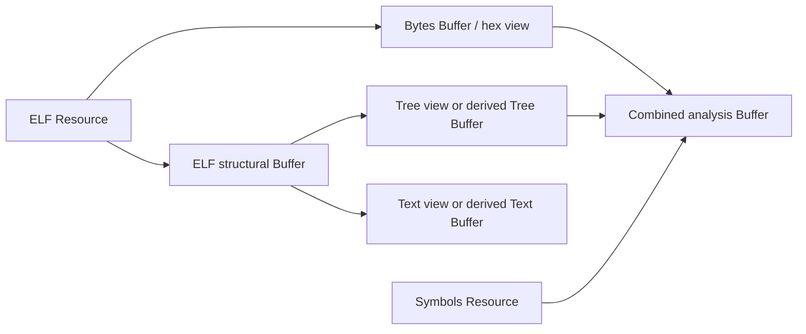
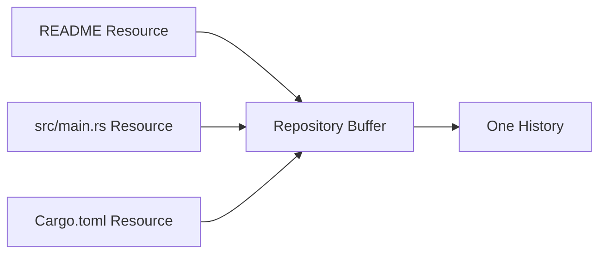

# Buffer state, editing and lifetime

This chapter owns working state, edit acceptance, snapshots and shared close.
[Resource access](01-resources.md) owns identity and handles;
[source relationships](02.2-sources.md) own live attachments and capture.

## Buffer identity and lookup

A Buffer is a Resource with editable working state, revision and History.
A snapshot is owned read access to an immutable selected state. Neither a source
path nor a data-interface type identifies a Buffer. All Buffer access uses the
common Resource identity and lifecycle; there is no parallel Buffer registry.

```rust
pub struct BufferState {
    pub buffer: ResourceId,
    pub revision: u64,
}
pub struct BufferDescriptor {
    pub state: BufferState,
    pub history: ResourceId,
}
```

BufferState is copied currentness metadata, granting and retaining nothing.
Every accepted edit or attachment change advances the revision. Returning to
an equal value, including through Undo, cannot revive an old precondition.
Buffer wrappers own granted Resource access; their state/history observations
are metadata returned by describe as BufferDescriptor. Source association data
is inspected separately. Snapshot wrappers own independent read access to state.

```rust
impl BufferService {
    async fn find(&self, id: ResourceId) -> Result<Buffer, RequestError>;
    async fn for_source(&self, id: ResourceId)
        -> Result<Vec<ResourceId>, RequestError>;
    async fn create(&self, source: &ResourceHandle)
        -> Result<Buffer, RequestError>;
}
```

find accepts an existing Buffer's ID, never a source ID with implicit selection.
It acquires available caller-granted Buffer access; restricted callers may
observe while editing still rejects. set_access narrows that handle when needed.
for_source lists visible associated Buffer IDs; enumeration retains no access
and its results may become stale before find. Large enumerations use bounded
pages. Two find calls share state/History; two create calls create independent
state/History even when supplied the same source.

create uses the service's explicitly configured factory, which defines supported
source/initialization interfaces. A different factory is selected through its
ordinary declared exec/ioctl, as in the [domain examples](07-domain-apis.md).
Factories also accept unbacked initial values or typed multiple inputs.

## A graph, with distinct relationship meanings

Multiple sources can feed one Buffer; one source can feed multiple Buffers.
Buffers can be nested in these relationships without implying recursive save
or a single-parent ownership tree. Namespace containment and History branches
are separate relationships, with their own traversal and lifetime rules.

| Relationship | State/History | Forward operation | Reverse operation |
| --- | --- | --- | --- |
| Alternate view | Same Buffer and History | Interpret selected state | Declared edit mapping |
| Derived Buffer | Independent Buffer and History | Capture/import/transform | Explicit supported publication |
| Combined inputs | One result, several input states | Declared composition | Explicit target mapping |
| Naming | No state copy | Locate subject | None |

One Buffer may support Bytes and Text views while preserving one authoritative
state. A hex display is presentation of Bytes; it need not create new editable
state. Users can still create an independent byte/hex working Buffer when that
is the intended workflow. A view binding performs no implicit transformation.

An ELF parser can produce custom structural, Tree and textual interfaces.
Those may be views over one lossless ELF state or separately derived Buffers.
The provider declares which; neither the type name nor a path establishes it.



The diagram shows permitted flow, not five compulsory allocations. Exact views
versus derived Buffers are selected by the declared operation. A Tree node or
Mesh vertex need not become a Resource solely because it appears in a view.

## Aggregate state

A repository-style aggregate is a direct many-Resource-to-one-Buffer case:



The Repository Buffer owns one editable state mapping logical paths to selected
member contents/identities. Members need not be Buffers, and their contents are
not concatenated into one byte string. The provider defines repository-wide
operations such as changing several entries, adding/removing entries and
renaming a path. One accepted aggregate edit produces one Buffer
revision/History edge.

Its snapshot retains the selected aggregate state and per-member provenance.
An input change is not an automatic edit of that snapshot or working state.
Refresh/import must reconcile the selected member set and local edits. Saving
or exporting the aggregate uses declared per-member mappings and the publisher's
actual commit scope; one Buffer edit does not prove atomic external filesystem
updates. A Git index/commit protocol, if offered, is a separate domain API.

copy of a Buffer captures its current state into a new Buffer with fresh History
and no inherited live source/publication bindings. It requires the provider's
state-copy/factory support and returns Unsupported only where that operation is
unavailable. Copying History or live subscriptions is a separate explicit
action.

## Atomic installation

An edit changes working state through an ordinary Resource request, including
supported byte writes and accepted imports. [Domain APIs](07-domain-apis.md)
supply typed snapshots and edits; [semantic values](03.1-representation.md)
qualify intent with the exact interpretation/state it used.

The commit cut begins the infallible installation of state and History:

```text
semantic intent + observed state
  -> Runtime: authorize, prepare and validate outside Core authority
  -> Core: recheck currentness, grants and the selected History edge
  -> commit cut: install working state + History atomically
  -> Runtime: release retired state/candidates outside Core authority

// Rejection changes neither state nor History.
// After the cut, under Core authority: no I/O, wait, callback or fallible step.
// Clients submit semantic edits, never native plans, nodes or executor jobs.
// Source observation is read-only; an accepted import uses this edit path.
```

Only the authorized [preparation provider](06.3-state-providers.md) supplies
candidates; ordinary modules call the semantic edit API. Before acceptance,
the request owns its candidate. Acceptance transfers retained state to History
and updates the Buffer's selected node. Retired/rejected state is released
outside guards; observer wakes happen after installation outside state guards.
Event delivery and result adoption are independent.

The first profile accepts one transaction per History step. Grouped typing,
dragging and painting still need defined intermediate feedback, peer visibility,
confirm/cancel behavior and an Undo unit. Grouping Buffers creates no
cross-Resource transaction. [History](02.1-history.md) owns branching, edge
selection and retained inspection.

Accepted changes report exact request/state/transition. Client cursor, selection
and follow policy do not gate acceptance. Authored masks/styles are content;
zoom and computed layout are Client policy. [Publication](02.3-publication.md)
is a separate external effect that Undo cannot retract.

## State retention

History retains accepted state; a snapshot retains its selected immutable value
independently of later edits or shared close. Neither requires copying all data
or making all content resident. Sparse/deferred reads must preserve that exact
state and report unavailable/expired data rather than substituting current data.
[State providers](06.3-state-providers.md) own retention and snapshot callbacks.

Quota accounting covers retained state, snapshots, candidates and pending work.
Reserve capacity before acceptance; pressure cannot discard a committed result
or unresolved cleanup. Reclaiming backing still needed by an admitted operation
requires transfer to another owner, not merely dropping the caller's wait.

## Shared close and graph lifetime

Handle close releases access; shared Buffer close ends editing under owner and
currentness checks. Modified-state policy, outstanding work and attachment
cleanup are explicit. Independent immutable snapshots can survive shared close.
No namespace removal or backing detach silently discards unsaved state.
History access cannot keep a closed Buffer editable or authorize shared close.

Strong access, dataflow, namespace and module dependency graphs have different
cycle rules. A self-reference cannot become implicit permanent ownership.
Creation of a cyclic live derivation must either be rejected by its declared
composition interface or include an explicit bounded evaluation/fixpoint policy.
There is no automatic recursive evaluator implied by this API. Explicit retained
snapshot inputs remain ordinary immutable dependencies, not live subscriptions.

`ClosePolicy::RejectModified` protects unpublished state, including unbound
or unexported data. `DiscardLocal` explicitly authorizes local loss; it cannot
roll back external effects. The creating lifecycle scope owns shared close;
ordinary WRITE alone does not transfer that authority. Save completion never
authorizes discarding later edits: capture fresh state before requesting close.
Closed identity metadata permits idempotent close without retaining provider
code. Incomplete shutdown stays fenced and progressable under Runtime custody.
