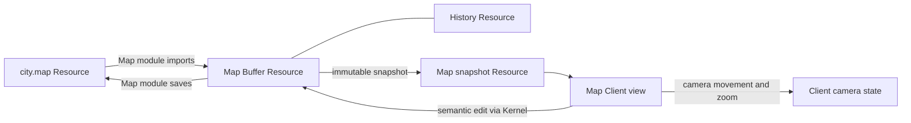

# A .map file, 3D movement and zoom across the layers

This worked example uses pseudocode, not implemented SDK signatures. A map
contains objects at world positions: x east, y north, z up, in metres relative
to the map's fixed origin. A camera is one Client view's position and zoom.
Moving the camera navigates the view; moving an object edits map content.

The Map feature pairs a Kernel module with one map-client module for CLI,
TUI and Web; [Client module research](09.1-client-modules.md) develops its API.
Each uses its owning Runtime. [Composition](05.1-composition.md) owns wiring.

## Owners and code locations

Contribution paths below illustrate placement; they require no new packages
merely to hold this example. Server and embedded assembly use the same owners.

| Code home | Responsibility in this example |
| --- | --- |
| `extensions/map/api/` | Map types, operation declarations, typed wrappers |
| `extensions/map/kernel/` | .map reading/writing, state, factory, snapshots, edits, publication |
| `extensions/map-client/{api,src}/` | Client schema, shared camera commands, context and presentation helpers |
| `clients/<family>/{contract,core,runtime}/` | Client interfaces, input dispatch, views, module execution |
| `sdk/<language>/` | Granted access, checked calls, request encoding and recovery |
| `kernel/interface/` | Common Resource, Buffer/History and provider contracts |
| `kernel/runtime/` | Module lifetime, admission, dispatch, observation, cleanup |
| Kernel Core implementation | Atomic working-state and History installation |
| `resource/file/`, exported by the files Kernel module | File access, coherent capture, conditional publication |
| `host/` adapters | Native filesystem, network, input and display operations |
| `apps/server/` service adapter | Authenticate/decode remote calls and forward to Runtime |
| `apps/` assembly | Select implementations, grants, modules and connections |

Map Kernel and Client modules depend on the Map API. Common Kernel, server and
SDK code use declared interfaces without importing map types. Native modules
can run beside Kernel in a server or embedded app;
[adapters](06.1-native-abi.md) own transport and native details.
Drawing remains Client-owned in either case.

## The file, Buffer and view

The Map Kernel module uses two private functions: `read_map(bytes) -> state`
and `write_map(state) -> bytes`. They implement the `.map` file format.

Illustrative `city.map` content read and written by that module:

```text
format: map-v1
frame: local-metres, x=east, y=north, z=up
objects: [{ id: 7, position: [10, 20, 0] }]
```



The file, Buffer, History and snapshot have distinct Resource identities.
Object 7 is an ID inside map state. The Buffer retains a source attachment to
the file; binding or opening the file alone creates no Buffer. [Buffer graphs
and snapshots](02-buffer.md) own these relationships and retained state.

## Public Map API and assembly

```text
// extensions/map/api: shared declarations; no live module instance here.
ObjectId = map-local stable ID
WorldPoint = { x: f64, y: f64, z: f64 }
MapObject = { id: ObjectId, position: WorldPoint }
MapEdit = MoveObject { id: ObjectId, to: WorldPoint }

MapFactory.exec(source: READ file access) -> Buffer
MapSnapshot.object(id: ObjectId) -> MapObject
MapSnapshot.objects(cursor, limit) -> bounded page of MapObject
Map.observe(buffer: READ access) -> { snapshot: MapSnapshot, watch }
Buffer.edit(expected: MapSnapshot, edit: MapEdit) -> accepted BufferState

// Application assembly, through each owner's public activation contract.
kernel = construct_kernel(config, granted_host_services)
kernel.modules.load("files")
kernel.modules.load("map")       // Publishes /modules/map/open.
client = construct_client(config.client, granted_client_services)
client.connect(kernel, caller_grants)
client.modules.activate("map-client", granted_kernel_access)
```

The Map API declares bounds, rights, schemas and stable object-ID meaning.
Snapshot reads use declared control calls. Creation and observe use factory
dispatch; edits use preparation dispatch. The [domain API](07-domain-apis.md)
and [declarations](06-declarations.md) explain those common mechanisms.
Each observe returns a coherent snapshot/watch under the
[observation contract](03-observation.md).

## Open the file and create a Buffer

This example selects a File API offering coherent byte snapshots and
conditional atomic replacement. Ordinary positional I/O alone promises
neither. Missing support reports Unsupported; native adapters must enforce
the selected guarantees. The `.map` suffix is Client selection policy.

```text
// Map Client module: explicit file access and factory selection.
file = await kernel.open("/files/city.map")
await file.set_access(READ)
factory = await kernel.resolve<MapFactory>("/modules/map/open")
buffer = await factory.exec(file)
view = await map_api.observe(buffer)

// Map Kernel module: factory callback, driven outside Core authority.
on create_map(source, creation):
    base = await file_api.capture_coherent(source)
    bytes = await base.read_bounded(MAX_MAP_BYTES)
    initial = try read_map(bytes)
    initial.provenance = { source: source.id, base: base.identity }
    // Validate version, frame, unique IDs, finite positions and quotas.
    // Retain data needed to preserve supported source content when writing.
    try creation.buffer({
        state: {
            initial: immutable(initial),
            implementation: map_operations(private_context)
        },
        attachments: [{
            key: "document", source: source, base: base,
            publish_to: source.id
        }],
        backing: { refresh: map_refresh, publish: map_publish }
    })
    return OK
```

`creation.buffer` stages state, operations and attachment together. Successful
completion publishes a new Buffer/History and caller access. The attachment
captures READ access under its retention grant; `publish_to` is only identity
metadata. The default role is `document`. [Source attachments](02.2-sources.md)
own this relationship; [factory records](06.3-state-providers.md) own staging.

Two clients finding this Buffer share its state/History. Calling the factory
twice creates independent Buffers, even with the same file. File changes do
not refresh them automatically. `map_refresh` explicitly reads a fresh file
snapshot, then prepares an import under the selected refresh policy.

## Snapshot reads, camera movement and zoom

```text
// Map Kernel module: immutable state produces a read-only Resource provider.
on state.snapshot(selected_state):
    return read_only_provider(MapSnapshot, retain(selected_state))

on MapSnapshot.object(id):
    return selected_state.lookup(id)   // Never substitute current Buffer state.

// Map Client module: private view state, driven by Client Runtime.
camera = { position: [0, 0, 10], zoom: 1 }

on MoveCamera(dx, dy, dz):
    camera.position = checked_add(camera.position, [dx, dy, dz])
    redraw(view.snapshot, camera)

on Zoom(factor):
    camera.zoom = checked_zoom(camera.zoom * factor)
    redraw(view.snapshot, camera)
```

Client adapters supply input; Client policy binds it to map-client commands.
The module maps gestures or explicit CLI arguments to world deltas and
positive zoom factors, validating finite values and view limits.
Its projection defines zoom 2 as twice zoom 1's projected size at the same
camera pose. `MoveCamera(1, 2, 3)` yields `[1, 2, 13]`; `Zoom(2)` yields 2.

`redraw` obtains bounded semantic data from the retained Map snapshot, applies
the Client camera/projection, and submits drawing through Client renderer and
output contracts to the display adapter. It may request more snapshot data;
camera changes create no map Buffer revision or History step.
[Clients](04-clients.md) own these policies, selection and hit-testing.

## Move a stored object through every execution layer

```text
// Map Client module: screen input is resolved against the shown snapshot.
on ConfirmObjectDrag(input):
    id, world_target = hit_test_and_map_drag(view.snapshot, camera, input)
    selected = await buffer.edit(view.snapshot,
        MoveObject { id: id, to: world_target })

// SDK -> local ABI, or service connection -> server adapter -> Kernel Runtime.
// All use the same bound declaration, granted access and request custody.
Runtime admits the request and selects the Buffer's registered Map edit table
Runtime supplies selected immutable before-state and a proposal capability

// Map Kernel module: the edit callback supplied at Buffer creation.
on prepare(before, MoveObject { id, to }, edit):
    validate_existing_object_and_finite_position(before, id, to)
    candidate = immutable_copy_with_position(before, id, to)
    try edit.propose(candidate)
    return OK

// Kernel implementation, after provider preparation succeeds.
Runtime validates the result and reserves required capacity
Core rechecks currentness, grants and the selected History edge
Core installs candidate + History step atomically
Runtime completes the request and publishes change observation outside guards
```

During dragging, the Client shows a local preview. Confirm submits one edit;
cancel before submission discards the preview. An intervening edit reports a
stale/conflict result instead of moving an object from an obsolete observation.
After submission, cancellation follows [request outcomes](01.3-requests.md).

Moving object 7 to `[11, 22, 3]` changes Buffer state; `city.map` still contains
`[10, 20, 0]`. Each watching Client obtains current snapshot data and redraws
with its own camera. Correlate accepted state and observations; a watch gap
requires a fresh coherent observation. [Buffer](02-buffer.md) owns acceptance.

## Save the Buffer back to city.map

```text
// Map Client command; selected is the actual accepted BufferState above.
saved = await publication.save(selected)

// Runtime resolves the retained document target/base under this caller.
// It acquires independent WRITE access and retains the selected state.

// Map Kernel module's backing callback, outside Core authority.
on map_publish(selected_state, targets):
    target = targets["document"]       // Granted WRITE and retained base.
    bytes = try write_map(selected_state)
    outcome = await file_api.replace_if_base(target.access, target.base, bytes)
    return [{ key: "document", destination: target.access.id, outcome }]

// File implementation -> granted filesystem Host adapter -> native storage.
// Runtime records confirmed publication for the matching attachment/base.
```

Successful Save publishes `[11, 22, 3]`. A changed file base reports Conflict;
missing WRITE reports Denied. Unknown effects retain the original request for
reconciliation. Later Buffer edits remain unsaved.
[Publication](02.3-publication.md) owns guarantees and bookkeeping;
a saved base is not supplied by the Client.

Undo restores object state through History. It keeps each Client's camera and
does not undo a file publication. Closing a view releases its snapshot/watch
and Buffer access; shared close belongs to the Buffer's lifecycle owner.
Retained state/History may keep the Map module loaded after the view closes.
Optional camera persistence uses a Client-owned [Session](04.1-session.md)
schema; retaining context does not move camera execution into Kernel.
